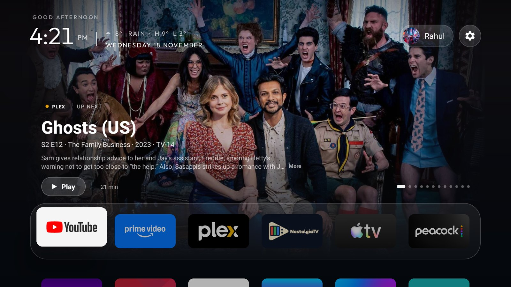
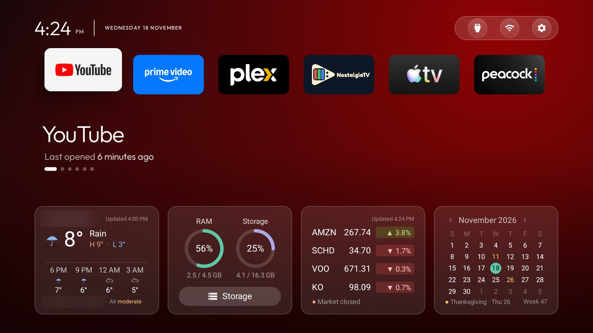

# CleanYourTV Dashboard

Two Home screens for Android TV and Google TV:

- **Plexed**: your Plex Home on the TV. A full-screen carousel of what you're watching and what was recently
  added to or released on your Plex server, with "Who's watching?" profiles, one row of apps and the weather beside the clock.
- **Dashboard**: a console-style Home with one row of your favourite apps near the top, a background in each
  app's own colour, and four glanceable cards for the weather, memory, stocks and the calendar.

It is a fork of [CleanYourTV](https://github.com/Gathin23/cleanyourtv), the project that strips the ads and
bloatware from Android TVs and replaces the Home screen with a small, fast, offline launcher. Everything
CleanYourTV does is still here and unchanged; this fork adds the two themes on top. CleanYourTV's own guide
(debloating, the launcher, the tools) is in [CLEANYOURTV.md](CLEANYOURTV.md).



## Plexed

| Feature | What you see |
|---|---|
| Hero carousel | 12 slides: first the 4 things you watched most recently (Plex's Continue Watching, and other apps' Watch Next), newest first; then 8 picked at random from what was added to or released on your Plex server in the last 30 days, picked afresh each time you come back to Home. Turns every 30 seconds; Left and Right step through it |
| Full-screen artwork | The item's own backdrop, wide at the top inside a U of its own colours |
| Details | The title, a details line (episode, year, rating, genres), and a two-line description; Up then OK opens it in full |
| Resume or Play | Resume picks up where you stopped, in Plex; Play starts a recent film, or a recent show's first unwatched episode |
| Up next | A show's next episode that you haven't started is tagged Up next, with Play and its running time instead of a progress bar |
| Who's watching? | A capsule with your Plex profile's picture and first name; pick another Plex Home profile and the carousel follows it |
| One row of apps | Your dock at the bottom, the next row peeking in, and All apps below; the focused app grows and the others dim |
| Weather and gear | The weather above the date, beside the clock; one gear for TV settings, network, apps, themes and the launcher's own settings |

### Linking your Plex account

1. Install the launcher and the Plexed data add-on, and push the theme (steps 1, 2 and 5 of [Install](#install),
   with `themes/plexed`).
2. On Home, go up to the **Who's watching?** capsule and press OK, then **Link Plex account**. The TV shows a code: enter it
   at [plex.tv/link](https://plex.tv/link) on your phone or computer, signed in to your Plex account. Nothing is
   typed on the TV, and the TV never sees your password.
3. The add-on asks plex.tv which Plex servers your account can reach, keeps the first one that answers (on your
   home network before over the internet, and through Plex's relay only when nothing else answers), and fills the
   carousel from it. Pick a profile in the capsule; a profile with a PIN asks for it.
4. Optional, for other apps' continue-watching rows (Watch Next) beside Plex's own:

   ```bash
   adb shell pm grant io.github.rahul051296.plexeddata android.permission.READ_TV_LISTINGS
   ```

To unlink, clear the Plexed data add-on's data (Settings, Apps, Plexed data, Clear data): its keys, saved lists
and pictures go with it.

### What goes where

- **plex.tv** gets the link code, then your account's key when the add-on asks for your Plex Home profiles, for a
  profile switch and for the list of your servers.
- **Your own Plex server** gets that key with each request for Continue Watching, the recent titles and their
  artwork. Only when the server can't be reached any other way (a friend's server that lets no one in from
  outside), those requests go through Plex's relay.
- **The weather services** ([Open-Meteo](https://open-meteo.com/), [wttr.in](https://wttr.in/) as a fallback)
  get a latitude and longitude (yours, or your time zone's main city), as with Dashboard.
- **Nothing else.** The keys stay in the Plexed data add-on's private storage on the TV; the launcher only sees profile names,
  pictures, titles and artwork, and keeps no copy. No account details, viewing data or anything about the TV goes
  anywhere but your own server and plex.tv.

### Storage

The Plexed data add-on keeps the pictures of the items in the carousel (up to about 4 MB for each profile you use) and deletes a
picture once no profile's list shows it.

## Dashboard



| Feature | What you see |
|---|---|
| Console-style row | One row of app banners near the top. Moving right slides the row, so the selected app stays in the first slot |
| Header | Clock and date top left; Inputs, Wi-Fi and Settings in a frosted-glass pill top right |
| Favourites only | Home shows just your favourite apps; everything else is one press away |
| All apps tile | The last tile in the row opens the app library. Hold OK on an app there to add it to Home or remove it |
| Per-app backgrounds | A soft gradient in the selected app's own colour, taken from its banner, cross-fades in behind Home |
| Weather card | Now, today's high and low, the next hours, sunrise, sunset and air quality |
| Memory card | RAM and storage rings, and a **Storage** button that opens the TV's storage settings, where you can clear an app's cache |
| Stocks card | Price and day change for up to four tickers (delayed). Hidden until you add some |
| Calendar card | The month, with today marked and US holidays |
| App opening zoom | The app grows out of its tile when it opens |
| Focus lift | The selected app rises on a soft shadow, turns to face you and catches a passing shine |
| **Themes** | Plexed and Dashboard sit beside CleanYourTV's own: thirty-one ship in [`themes/`](themes/), the built-in `default/` included |

Change the favourites by editing `dock_apps` in
[`themes/dashboard/config.json`](themes/dashboard/config.json), or from the TV: open All apps and hold OK
on an app. All of CleanYourTV's other themes still work; the Dashboard features stay off unless a theme
turns them on.

## What it needs, and why

- **The launcher** stays offline, as in CleanYourTV: no `INTERNET` permission, and no permissions beyond
  CleanYourTV's own. It names the two data add-ons in its `<queries>` so Android lets it read their data.
- **The Plexed data add-on** ([`addons/plexed-data`](addons/plexed-data)), everything Plexed needs, is a separate
  33 KB app with `INTERNET`, and `READ_TV_LISTINGS` for the TV's own Watch Next list (only once you grant it). It
  fetches only when Home asks and its reading is old (Plex after 5 minutes, the weather after 30); the weather is
  the same as Dashboard data's, without the stocks. See [what goes where](#what-goes-where).
- **The Dashboard data add-on** ([`addons/dashboard-data`](addons/dashboard-data)), for Dashboard's weather and
  stocks cards, is a separate 18 KB app with `INTERNET` and no other permissions. It has no background service,
  timers or tile: it fetches only when Home asks and its reading is old (weather after 30 minutes, stocks after
  15). Weather comes from [Open-Meteo](https://open-meteo.com/) (no key), with [wttr.in](https://wttr.in/) as a
  fallback; air quality from Open-Meteo; stock prices from Yahoo Finance chart data (delayed). It sends a
  latitude and longitude (yours, or your time zone's main city) to the weather services and your ticker symbols
  to Yahoo, nothing else.
- The launcher APK is about 617 KB, above the 576 KB limit CleanYourTV keeps for its own launcher: Plexed's
  carousel, profiles, the theme picker and the Dashboard cards are about 45 KB of code CleanYourTV doesn't have.

## Install

You need the same setup as CleanYourTV: a computer with ADB, and Network or Wireless debugging on the TV
(see [CLEANYOURTV.md](CLEANYOURTV.md) for the full walkthrough, including debloating).

```bash
# 1. Build and install the launcher
cd launcher && ./gradlew assembleRelease
adb install -r app/build/outputs/apk/release/app-release.apk

# 2. For Plexed: build and install the Plexed data add-on (Plex and the weather)
cd ../addons/plexed-data && ./gradlew assembleRelease
adb install -r app/build/outputs/apk/release/app-release.apk

# 3. For Dashboard instead: build and install the Dashboard data add-on (the weather and stocks cards)
cd ../dashboard-data && ./gradlew assembleRelease
adb install -r app/build/outputs/apk/release/app-release.apk

# 4. Optional: your exact place (underscores for spaces) and up to 4 stock tickers (Dashboard). For Plexed,
#    send the same lat, lon, place and unit to io.github.rahul051296.plexeddata/.SetupActivity
adb shell am start -n io.github.rahul051296.dashboarddata/.SetupActivity \
  --es lat 40.7128 --es lon -74.0060 --es place New_York --es unit f --es tickers VOO,AAPL,MSFT,KO

# 5. Push a theme: themes/plexed or themes/dashboard
cd ../.. && tools/theme.sh <tv ip> themes/plexed
```

Without step 4 the weather uses the main city of the TV's time zone (marked "Auto"), in °F in the US and °C
elsewhere, and Dashboard's stocks card stays hidden until you add tickers. Without the add-on at all, the
weather says how to get it.

## Theme keys

The two themes are switched on by these keys in a theme's `config.json`, on top of
[CleanYourTV's own keys](themes/README.md). Each is off, or at its usual size, when a theme leaves it out.

| Key | Value | What it does |
|---|---|---|
| `recent_hero` | package name | Plexed's hero carousel, from the data add-on |
| `recent_shelf` | package name | Instead, a row of Recently watched tiles under the dock |
| `recent_art_corner` | `0` or `1` | With `recent_shelf`, the focused item's artwork in the top-right corner |
| `focus_dim` | percent, `0`–`60` | While an app has focus, the others are this much darker |
| `weather_line` | package name | The data add-on to read the weather (and Dashboard's stocks) from |
| `weather_place` | text | A place name to show instead of the add-on's |
| `console_layout` | `0` or `1` | Dashboard's console-style row, the glass button pill and the four cards |
| `console_row_top` | dp, `0`–`400` | Space above the row of banners |
| `console_button_scale` | percent, `40`–`100` | Size of the buttons in the glass pill |
| `favourites_only` | `0` or `1` | Home holds only `dock_apps` and what you add from All apps |
| `dock_wallpapers` | `{"package": "file"}` | A picture from `wallpapers/` for each app; `_grid` is the All apps picture |
| `app_colour_backdrop` | `0` or `1` | Instead of pictures, a soft gradient in the focused app's own colour, taken from its banner |
| `app_open_zoom` | `0` or `1` | Apps grow out of their tile when they open |
| `hero_compact` | `0` or `1` | The app name and "Last opened" sit closer together |
| `focus_lift` | `0`, `1` or `2` | The focused app rises on a soft shadow, leans the way you moved and catches a passing shine, with no outline; `2` lifts it higher on a deeper shadow |
| `title_scale`, `font_scale` | percent | The big app name, and the clock and date |

## Tested on

- Sony BRAVIA 4K AE2, Google TV 14
- Sony BRAVIA 4K VH21 (X85K), Android TV 12

## Credits

Plex is a trademark of Plex, Inc.; this project is not affiliated with Plex. Built on [CleanYourTV](https://github.com/Gathin23/cleanyourtv) by Gathin23 and its contributors (MIT).
